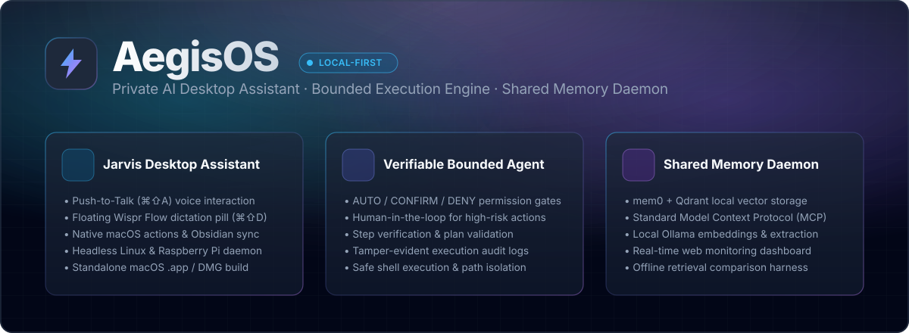
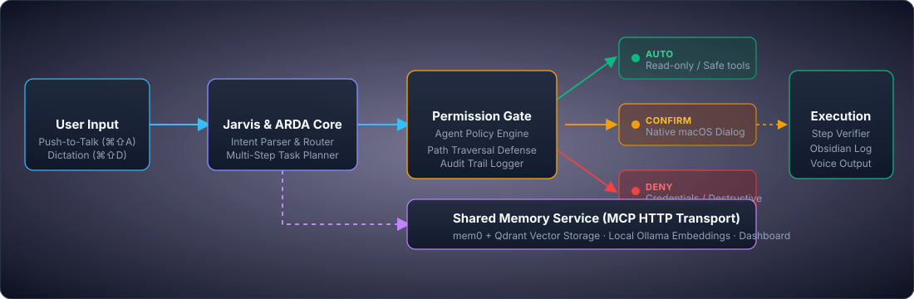

<p align="center">
  
</p>

<p align="center">
  <a href="https://github.com/yunusarda-sudo/arda-suite/actions/workflows/full-ci.yml"></a>
  <a href="LICENSE"></a>
  
  
  
  
  
</p>

---

**AegisOS** (formerly ARDA Suite) is a local-first desktop assistant and verifiable bounded agent runtime for macOS, Linux, and Raspberry Pi. It bridges the gap between **user intent and safe execution**—providing hands-free voice assistance and direct-cursor dictation for daily tasks, while constraining autonomous coding and research agents behind explicit permission gates, isolated sandbox runtimes, and a persistent shared memory brain.

Every component is independently deployable with its own Python environment, explicit boundaries, and testable invariants.

<p align="center">
  
</p>

---

## 🏛️ Core Pillars

- 🎙️ **Jarvis Desktop Assistant (`apps/jarvis`)**
  - **Voice & Push-to-Talk (`⌘⇧A`)**: macOS menu bar voice assistant with instant push-to-talk, conversation memory, and optional offline wake word.
  - **Wispr Flow-Style Dictation (`⌘⇧D`)**: Floating dictation emblem that transcribes spoken voice locally and pastes directly into the active cursor in any app.
  - **Desktop Automations & Notes**: Native macOS system controls (apps, volume, timer, screen lock) and automatic Obsidian vault task and note sync.
  - **Cross-Platform**: Headless background daemon mode for Linux and Raspberry Pi with offline Vosk speech recognition.
  - **Distribution**: Packaged into native macOS `.app` bundle or installable `.dmg` (`make app`, `make dmg`).

- 🛡️ **Verifiable Bounded Execution (`apps/jarvis/arda`)**
  - **Permission Gates**: Every tool invocation is governed by an explicit `AUTO / CONFIRM / DENY` policy.
  - **Sandbox Isolation**: Worker fleet executes inside digest-pinned, rootless Podman containers with zero network egress and isolated Git working trees.
  - **Lease Fencing & CAS**: Core remains the sole authority for advancing accepted Git refs; workers create candidates but cannot publish without Core verification.
  - **Step Verification & Audit Trails**: Multi-step plans are cryptographically verified; full audit trails are recorded for post-mortem inspection.
  - **Local-First Privacy**: Powered by local Ollama models by default; cloud LLM providers are strictly opt-in.

- 🧠 **Persistent Central Brain (`services/memory`)**
  - **Vector Memory**: Standalone service powered by [mem0](https://github.com/mem0ai/mem0) and [Qdrant](https://qdrant.tech/) vector storage.
  - **Model Context Protocol (MCP)**: Standardized stdio and authenticated HTTP MCP interfaces with bearer-token security.
  - **Reflexion & Learning**: Automated lesson extraction from operational failures, rule engine, and token accounting.
  - **Control Center & Dashboard**: Real-time management UI, job cancellation, automated compaction, and retrieval evaluation harness.

---

## 🗺️ Architectural Roadmap & Work Packages

AegisOS is built through rigorous, test-driven work packages documented under [`apps/jarvis/docs/plans/`](apps/jarvis/docs/plans/):

| Package | Focus Area | Key Deliverables | Status |
| :--- | :--- | :--- | :--- |
| **P0-A** | [Lease Fencing](apps/jarvis/docs/plans/P0A_LEASE_FENCED_ACCEPTANCE.md) | Core SQLite durable intent, Git update-ref CAS, candidate validation | `Merged` ✅ |
| **WP-1** | [Sandbox Execution](apps/jarvis/docs/plans/WP1_HERMES_SANDBOX_EXECUTOR.md) | Rootless Podman isolation, single-tool MCP server, cancellation propagation | `Merged` ✅ |
| **WP-2** | [Autonomous Director](apps/jarvis/docs/plans/WP2_AUTONOMOUS_DIRECTOR.md) | Mission intake, goal breakdown, priority queue, policy evaluation | `Merged` ✅ |
| **WP-3** | [Worker Fleet](apps/jarvis/docs/plans/WP3_PERSISTENT_WORKER_FLEET.md) | Multi-worker coordination, browser egress adapter, ephemeral sessions | `Merged` ✅ |
| **WP-4** | [Model Gateway](apps/jarvis/docs/plans/WP4_MODEL_GATEWAY_AND_EVIDENCE_MEMORY.md) | BudgetedModelGateway, provider fallback/cooldown, evidence memory ledger | `Merged` ✅ |
| **WP-5** | [Control Center & CI](apps/jarvis/docs/plans/WP5_CONTROL_CENTER_CI_PILOT.md) | Versioned job cancellation, full dual-venv GitHub CI, offline backup/restore | `Merged` ✅ |
| **WP-6** | [Pi & Recovery Gate](apps/jarvis/docs/plans/WP6_PI_HARDWARE_AND_RECOVERY_GATE.md) | Physical device verification, `arda.recovery` rehearsal, daemon lifecycle | `In Progress` 🔄 |
| **WP-7** | [72h Autonomy Pilot](apps/jarvis/docs/plans/WP7_72H_AUTONOMY_PILOT.md) | 72-hour continuous autonomy pilot, chaos fault injection, go/no-go scorecard | `Planned` 📋 |
| **WP-8** | [Standalone Packaging](apps/jarvis/docs/plans/WP8_MACOS_STANDALONE_RELEASE.md) | Portable macOS bundle distribution, lazy import decoupling, DMG pipeline | `In Progress` 🔄 |
| **WP-9** | [External MCP Clients](apps/jarvis/docs/plans/WP9_EXTERNAL_MCP_CLIENTS.md) | Claude Desktop / Code verified configurations, Issue #16 resolved | `Merged` ✅ |

---

## 🔌 Verified Client Ecosystem

AegisOS connects seamlessly to modern developer and assistant workflows:

- 🤖 **Claude Code (CLI):** Connect via `claude mcp add-json mem0-brain` using `headersHelper` and authenticated HTTP transport.
- 💻 **Claude Desktop:** Verified stdio integration for local brains, and `mcp-remote` secure bridge for remote central brains. See [One Brain, Many Workers](services/memory/docs/SINGLE-BRAIN.md).
- 📝 **Obsidian:** Automatic Markdown vault synchronization for notes, action items, and task tracking.
- 📱 **Mobile & Siri Shortcuts:** Loopback-protected Siri Shortcuts integration for voice capture into the shared brain. See [Siri Shortcuts Guide](services/memory/docs/SIRI-SHORTCUTS.md).

---

## 🚀 Quickstart

### 1. Repository Setup & Test Suites

The repository enforces strict environment isolation between Jarvis and Shared Memory:

```bash
# Setup isolated virtual environments for both components (Python 3.11+)
make setup-test-env

# Run full test suites and shell security checks
make test-jarvis    # 1500+ unit and integration tests
make test-memory    # 870+ vector store and MCP transport tests
make check-shell    # Validates all shell scripts and bin utilities
```

### 2. macOS: Jarvis Desktop Assistant

```bash
cd apps/jarvis

# Setup virtual environment and dependencies
python3.11 -m venv .venv
source .venv/bin/activate
pip install -r requirements.txt

# Configure local preferences
cp config.local.example.yaml config.local.yaml

# Run tests and doctor check
make test
make doctor

# Build macOS app bundle and distributable DMG
make app            # Generates dist/Jarvis.app
make dmg            # Packages installable dist/Jarvis.dmg
```

> **Automated Setup:** You can also run `./install.sh` inside `apps/jarvis/` for automated installation of Homebrew, ffmpeg, audio libraries, and local Ollama models.

### 3. Linux / Raspberry Pi: Shared Memory & Daemon

```bash
cd services/memory

# Automated Pi installer (Docker, Qdrant, Ollama, systemd)
./scripts/install-pi.sh

# Run offline recovery rehearsal (WP-6)
cd ../../apps/jarvis
./scripts/rpi_recovery_rehearsal.sh --exercise-sandbox
```

Review the [Shared Memory Guide](services/memory/README.md) and [Raspberry Pi Setup](services/memory/docs/RASPBERRY-PI-SETUP.md) for full configuration details.

---

## 🧩 Architecture & Boundaries

| Component | Directory | Focus & Capabilities |
| :--- | :--- | :--- |
| **Jarvis Assistant** | [`apps/jarvis/`](apps/jarvis/) | Menu bar UI, voice capture, dictation emblem, macOS automation, Linux daemon |
| **Aegis Core** | [`apps/jarvis/arda/`](apps/jarvis/arda/) | Task intake, permission gates, step verifier, execution bridge, recovery engine |
| **Shared Memory** | [`services/memory/`](services/memory/) | Vector store, MCP HTTP & stdio servers, dashboard, evaluation harness |

Components communicate strictly across documented API and MCP boundaries. Jarvis never imports the memory service source tree directly. See [Product Layout & Data Policy](docs/PRODUCT_LAYOUT.md).

---

## 📚 Technical Documentation

For in-depth architectural specifications, ADRs, and verification records:

- 📖 **Documentation Hub:** [Maintainer guides and component index](docs/README.md)
- 📐 **Architecture Deep Dive:** [Jarvis & Aegis Architecture](apps/jarvis/docs/ARCHITECTURE.md)
- 📋 **Engineering Evidence:** [Engineering Notes & Decision Matrix](docs/ENGINEERING_NOTES.md)
- 📑 **Specifications Index:** [Core Specifications & Contracts Archive](apps/jarvis/docs/specs/README.md)
- 💾 **Disaster Recovery Runbook:** [Backup, Restore, and Incident Rollback](apps/jarvis/docs/RECOVERY.md)
- 🔒 **Security Policy:** [Vulnerability Reporting & Loopback Boundaries](SECURITY.md)

---

## 📄 License & Contributing

Licensed under the **Apache License 2.0**. See [LICENSE](LICENSE) for details.

Interested in contributing? Start with our [Contributing Guidelines](CONTRIBUTING.md). Please report security vulnerabilities responsibly according to our [Security Policy](SECURITY.md).
