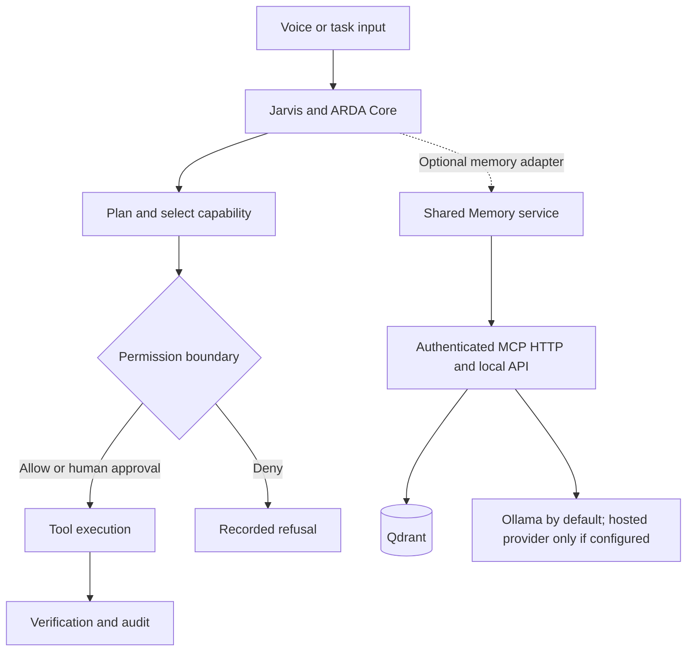

# ARDA Suite

**A Raspberry Pi 5-focused, local-first assistant stack with bounded agent execution and optional shared memory.**

ARDA Suite brings three related but independently deployable components into one source repository: **Jarvis**, a macOS desktop assistant with a separate Linux daemon path; **ARDA Core/Hermes**, experimental task and runtime infrastructure; and **Shared Memory**, an optional memory service. Raspberry Pi 5 is the primary target for the self-hosted Linux deployment, while each component keeps its own Python environment and deployment lifecycle.

## Raspberry Pi 5 deployment focus

The stack is being adapted for a self-hosted Raspberry Pi 5 deployment. The Shared Memory setup is tailored for Pi/Linux hosts with local Ollama models, an ARM64 Qdrant container, loopback-only service bindings, and systemd-managed services. These choices keep the default memory path on the device and avoid requiring hosted model credentials.

Jarvis also has an existing macOS desktop app, and its Linux daemon is installed separately. The Pi-specific services and defaults are in place, but the live Raspberry Pi, hardware performance, and full end-to-end integration have not yet been verified. This is a target-platform and customization focus, not a claim of a validated Pi release.

This is an engineering work in progress, not a production-ready autonomous multi-agent platform.

## The engineering problem

An agent that returns a plausible answer is different from one that can safely change files or call tools. ARDA explores the engineering between **intent and action**: permission gates, constrained execution, verification, audit trails, and persistent context.



## Engineering evidence

| Question | Implementation and evidence |
| --- | --- |
| How are tool calls permissioned? | [Permission policy](apps/jarvis/arda/agent_permission.py), [tool registry](apps/jarvis/arda/agent_tools.py), [permission tests](apps/jarvis/tests/test_agent_permission.py) |
| How does a multi-step task run and get observed? | [Executor](apps/jarvis/arda/agent_executor.py), [step verifier](apps/jarvis/arda/agent_verifier.py), [audit log](apps/jarvis/arda/agent_audit.py) |
| Where is task state coordinated? | [Control plane](apps/jarvis/arda/control_plane.py), [execution bridge](apps/jarvis/arda/execution_bridge.py) |
| How do clients authenticate to Shared Memory? | [MCP transport](services/memory/mcp_transport.py), [transport tests](services/memory/test_mcp_transport.py) |
| How is memory kept outside the application lifecycle? | [Memory service](services/memory/mcp_server.py), [component and data boundaries](docs/PRODUCT_LAYOUT.md) |
| Which design decisions are documented? | [Jarvis architecture](apps/jarvis/docs/ARCHITECTURE.md), [ARDA Core spec](apps/jarvis/ARDA_CORE_V0_1_SPEC.md), [Hermes orchestration contract](apps/jarvis/HERMES_V0_1_ORCHESTRATION_CONTRACT.md) |

These links point to implementation and design evidence. They do not establish that every path has been validated on physical hardware.

## Components and maturity

| Component | Location | Scope and maturity |
| --- | --- | --- |
| **Jarvis** | [`apps/jarvis/`](apps/jarvis/) | Existing macOS voice and desktop assistant, with an optional Linux daemon path |
| **ARDA Core/Hermes** | [`apps/jarvis/arda/`](apps/jarvis/arda/) | Experimental task intake, execution, provider bridge, and evaluation modules; production multi-agent orchestration is not claimed |
| **Shared Memory** | [`services/memory/`](services/memory/) | Optional mem0/Qdrant-backed storage, MCP transport, dashboard, and maintenance tools |

The components have separate Python environments. Jarvis does not import the memory service's source tree. See the [product layout and data policy](docs/PRODUCT_LAYOUT.md).

## Operating and security boundaries

- Tool execution uses explicit **AUTO / CONFIRM / DENY** decision paths. A permission policy is not a verified OS sandbox.
- Shared Memory MCP HTTP and dashboard listeners bind to loopback by default. HTTP MCP requires bearer-token authentication. See the [transport implementation](services/memory/mcp_transport.py) and [security policy](SECURITY.md).
- The Pi installer now creates a local Ollama configuration by default and fails if model downloads, local Qdrant/Ollama readiness checks, or the initial memory health command fail. See the [Pi installer](services/memory/scripts/install-pi.sh) and [memory component guide](services/memory/README.md).
- Hosted LLM providers are opt-in. When configured, memory extraction content is sent to that provider; keep credentials in the ignored private config or OS secret store.
- Source control excludes private memory contents, runtime databases, tokens, model weights, and machine-specific settings. This repository is not a backup of live systems.

## Run and evaluate

Use separate environments for Jarvis and Shared Memory. From the repository root:

```bash
make test-jarvis
make test-memory
make check-shell
```

The current GitHub Actions workflow checks shell syntax and the Shared Memory Pi installer safety tests. It does not run the full combined test suites.

For the macOS Jarvis development setup:

```bash
cd apps/jarvis
python3.11 -m venv .venv
source .venv/bin/activate
pip install -r requirements.txt
cp config.local.example.yaml config.local.yaml
make test
```

Fill in local paths and any provider credentials in the ignored `apps/jarvis/config.local.yaml`. See the [Jarvis guide](apps/jarvis/README.md) for microphone permissions and app usage.

For Raspberry Pi/Linux installation, follow the [Pi setup guide](services/memory/docs/RASPBERRY-PI-SETUP.md) and install Jarvis separately. Review the existing host's Docker, systemd, memory ownership, and provider settings before upgrading it.

## Known limits and validation status

- **Physical Pi not inventoried:** the Raspberry Pi was unreachable when this repository was assembled. Its live service configuration, database ownership, and repository inventory have not been verified.
- **Full-suite status:** the full combined Jarvis and Shared Memory suites have not been run for this portfolio snapshot. The focused installer safety check and shell syntax workflow have passed.
- **Runtime maturity:** contracts, tests, and modules do not establish end-to-end autonomous reliability or effective OS sandbox isolation.
- **Deployment claims:** a passing local test or CI run does not prove production readiness or Raspberry Pi performance.

## Repository map

```text
apps/jarvis/        Jarvis assistant, ARDA Core, Hermes bridge, tests
services/memory/    Shared Memory / MCP, dashboard, tests, installers
docs/               Packaging, data ownership, and deployment boundaries
SECURITY.md         Private vulnerability reporting
```

**Reviewer starting points:** [permission boundary](apps/jarvis/arda/agent_permission.py) · [execution bridge](apps/jarvis/arda/execution_bridge.py) · [MCP transport](services/memory/mcp_transport.py) · [tests](apps/jarvis/tests/) · [data policy](docs/PRODUCT_LAYOUT.md).

The goal is to make execution behavior inspectable, bounded, and testable—not just convincing in a demo.
