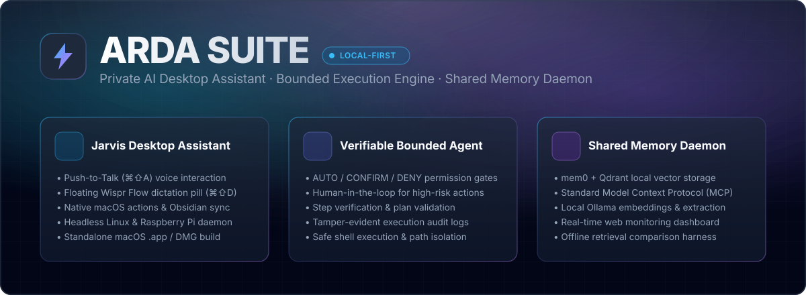
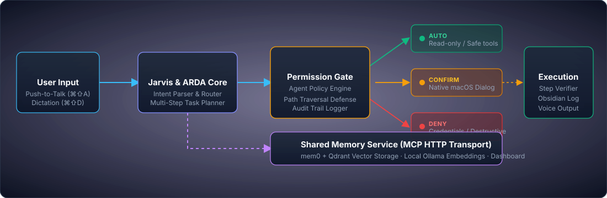

<p align="center">
  
</p>

<p align="center">
  
  
  
  
  
</p>

---

**ARDA Suite** is a modular, privacy-first AI assistant and bounded agent runtime. It bridges the gap between **user intent and safe execution**—combining a desktop voice assistant, explicit human-in-the-loop permission boundaries, and an independent shared memory daemon.

Each component is independently deployable with its own Python environment and isolated lifecycle.

<p align="center">
  
</p>

---

## Key Pillars

- 🎙️ **Jarvis Desktop Assistant (`apps/jarvis`)**
  - **Voice & Push-to-Talk (`⌘⇧A`)**: macOS menu bar voice assistant with instant push-to-talk and optional wake word.
  - **Wispr Flow-Style Dictation (`⌘⇧D`)**: Floating dictation emblem that transcribes spoken voice directly into the active cursor in any app.
  - **Desktop Automations & Notes**: Native macOS system control (apps, volume, timer, screen lock) and automatic Obsidian vault task sync.
  - **Cross-Platform**: Headless background daemon mode for Linux and Raspberry Pi with offline speech recognition (Vosk).
  - **Packaging**: Builds directly into native macOS `.app` bundle or distributable `.dmg` (`make app`, `make dmg`).

- 🛡️ **Verifiable Bounded Execution (`apps/jarvis/arda`)**
  - **Permission Gates**: Every tool invocation is governed by an explicit `AUTO / CONFIRM / DENY` policy.
  - **Step Verification & Audit Trails**: Multi-step plans are verified and logged; high-risk actions require human sign-off.
  - **Local-First Privacy**: Powered by local Ollama models by default; cloud LLM providers are strictly opt-in.

- 🧠 **Persistent Shared Memory (`services/memory`)**
  - Standalone service using [mem0](https://github.com/mem0ai/mem0) and [Qdrant](https://qdrant.tech/) vector storage.
  - Standardized **Model Context Protocol (MCP)** interface with bearer-token authentication.
  - Real-time management dashboard, automated compaction, and retrieval evaluation harness.

---

## Architecture & Components

| Component | Directory | Focus & Capabilities |
| :--- | :--- | :--- |
| **Jarvis Assistant** | [`apps/jarvis/`](apps/jarvis/) | Voice intake, macOS system actions, menu bar UI, Linux daemon |
| **ARDA Core** | [`apps/jarvis/arda/`](apps/jarvis/arda/) | Task intake, permission gates, step verifier, execution bridge |
| **Shared Memory** | [`services/memory/`](services/memory/) | Vector memory service, MCP server, web dashboard, evaluation tools |

The components communicate across documented API and MCP boundaries. Jarvis does not import the memory service source tree, ensuring clean separation of concerns. See [Product Layout & Data Policy](docs/PRODUCT_LAYOUT.md).

---

## Quickstart

### 1. macOS: Jarvis Desktop Assistant

```bash
cd apps/jarvis

# Setup virtual environment and dependencies
python3.11 -m venv .venv
source .venv/bin/activate
pip install -r requirements.txt

# Configure local environment
cp config.local.example.yaml config.local.yaml
make test
```

> **Tip:** You can also run `./install.sh` inside `apps/jarvis/` for automated setup of prerequisites (Homebrew, Ollama models, and audio dependencies). See the [Jarvis Guide](apps/jarvis/README.md) for microphone configuration.

### 2. Linux / Raspberry Pi: Shared Memory Service

```bash
cd services/memory

# Run automated service installer (Docker, Qdrant, Ollama, systemd)
./scripts/install-pi.sh
```

Review the [Shared Memory Guide](services/memory/README.md) and [Raspberry Pi Setup](services/memory/docs/RASPBERRY-PI-SETUP.md) for configuration details.

---

## Development & Verification

Run tests and linting from the repository root:

```bash
# Verify shell scripts
make check-shell

# Run Jarvis test suite
make test-jarvis

# Run Shared Memory test suite
make test-memory
```

---

## Technical Documentation & Specifications

For in-depth architectural specifications, ADRs, and verification records:

- 📐 **Architecture Deep Dive:** [Jarvis Architecture](apps/jarvis/docs/ARCHITECTURE.md)
- 📋 **Engineering Evidence & Design Matrix:** [Engineering Notes](docs/ENGINEERING_NOTES.md)
- 📑 **Specifications & Contracts Archive:** [ARDA Core & Hermes Specs](apps/jarvis/docs/specs/README.md)
- 🔒 **Security & Boundary Policies:** [SECURITY.md](SECURITY.md)
- 📦 **Component Boundaries & Data Ownership:** [Product Layout](docs/PRODUCT_LAYOUT.md)

---

## License & Contributing

Built for local-first, verifiable AI assistance. Please report any security vulnerabilities responsibly according to our [Security Policy](SECURITY.md).
