# P0-A: Lease-Fenced Durable Acceptance

## Purpose and boundary

Make the Core the only authority that advances an accepted Git ref. A worker
may create a candidate commit and verified evidence, but cannot publish the
accepted baseline itself. This change does not integrate Hermes sandboxing,
enable autonomous discovery, merge to `main`, or deploy to the Raspberry Pi.

## Milestones

1. **Inspect** — Core schema, lease expiry/reclaim semantics, executor and
   harness boundary, episode records, and project test commands. Complete.
2. **Specify with tests** — stale lease, same-baseline competitors, crash
   boundaries, repeated recovery, CAS conflict, and cleanup/evidence truth.
3. **Implement** — durable intent in Core SQLite; exact lease/generation and
   baseline validation; Git `update-ref` expected-old CAS; idempotent
   reconciliation; candidate-only harness behavior.
4. **Verify** — focused tests followed by the project suite and diff review.
5. **Reviewable delivery** — feature branch and PR only; no merge or Pi deploy.

## State protocol

```mermaid
stateDiagram-v2
    [*] --> CandidateVerified
    CandidateVerified --> IntentPrepared: current lease + baseline + evidence verified
    CandidateVerified --> Conflict: baseline differs before intent promotion
    IntentPrepared --> Aborted: ref is old and lease no longer current
    IntentPrepared --> Promoting: BEGIN IMMEDIATE + lease recheck + update-ref CAS
    Promoting --> Accepted: ref == candidate; DB finalization commits
    Promoting --> Conflict: ref is neither old nor candidate
    IntentPrepared --> Accepted: recovery sees ref == candidate
    IntentPrepared --> Conflict: recovery sees unexpected ref
    Conflict --> [*]: no force reset; operator/retry required
    Aborted --> [*]: fresh lease and evaluation required
    Accepted --> [*]
```

The durable intent is committed before promotion. The coordinator then holds
SQLite's writer lock while it rechecks the lease and generation, performs Git
CAS, and finalizes job/task/intent state. If the process dies after the Git CAS
but before SQLite commit, the writer lock rolls back and the previously
committed intent remains for reconciliation. Concurrent lease renewal/reclaim
cannot win during the promotion transaction.

This fences all supported Core acceptance paths. It does not sandbox an
executor that shares the host Unix identity and can directly write the source
repository's `.git` directory. The current worktree shares Git metadata with
the source checkout; P0-B must enforce the OS boundary before claiming the
entire machine is protected from a compromised coding agent.

## Acceptance criteria and verification

- Harness returns candidate SHA and evidence; it does not advance the accepted
  ref.
- Stale/expired lease and stale generation cannot promote or complete.
- Intent records job/task, generation, old/candidate SHA, evidence digest,
  state, and timestamps.
- CAS uses expected old SHA. Recovery accepts the candidate ref idempotently,
  safely resolves an unchanged old ref, and records unexpected refs as
  conflicts without force reset.
- Cleanup/finalization failure cannot leave PASS evidence or episode state.
- Test actual temporary Git subprocess boundaries, injected crash points, and
  the existing suite.

## Risks and rollback

The design spans SQLite and Git, so it is not a cross-resource atomic
transaction; correctness depends on durable intent plus reconciliation. Any
unexpected ref is a conflict, never overwritten. Keep the feature isolated and
unmerged until tests and review pass. Roll back by reverting only this branch's
changes; do not reset accepted refs or touch the live Pi.

## Progress

- [x] Inspect source, lease behavior, and tests.
- [x] Add regression tests first, including child-process exits around Git/SQLite boundaries.
- [x] Implement coordinator, recovery, immutable result artifacts, and candidate-only harness.
- [x] Run available focused verification and review security-sensitive paths.
- [x] Open draft PR without merge/deployment: https://github.com/yunusarda-sudo/arda-suite/pull/7.

## Verification snapshot

- Focused Core/acceptance/bridge/harness suite: 62 passed.
- Python compile check for `arda/*.py`: passed.
- `git diff --check`: passed.
- Full repository suite is blocked in this checkout: the project `.venv` is
  absent, and system Python lacks `numpy`, `ollama`, and `yaml`; two collected
  Hermes tests also reference scripts not present in this checkout.
- Live Pi validation and deployment: not run.
