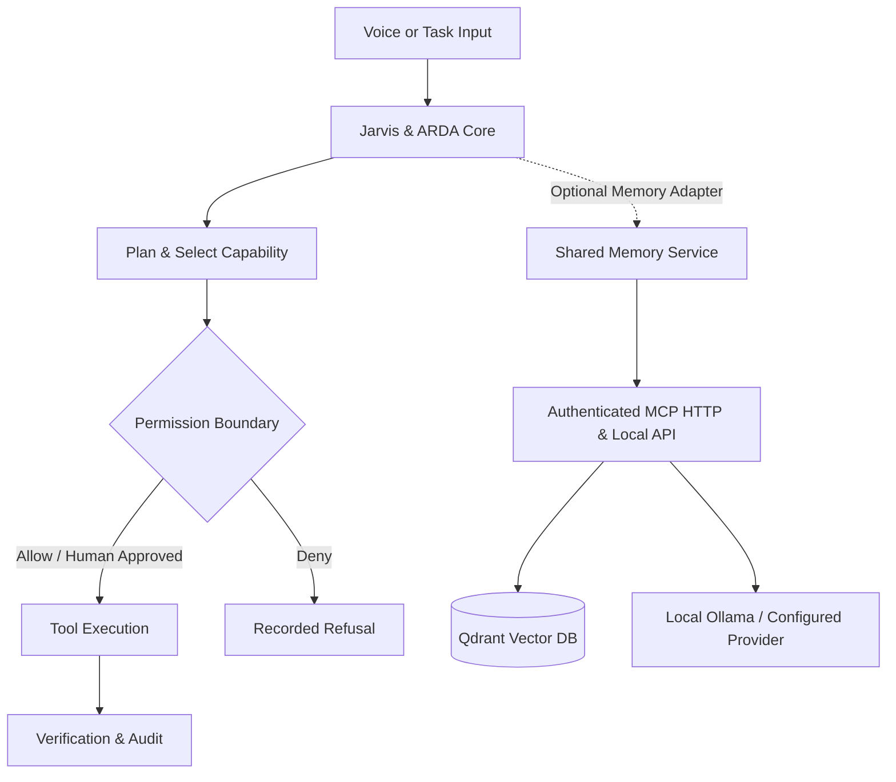

# ARDA Suite — Engineering Evidence & Architecture Notes

This document preserves the implementation evidence, design questions, and verification audit trails across the ARDA Suite codebase.

---

## The Engineering Problem

An agent that returns a plausible answer is different from one that can safely change files or call tools. ARDA explores the engineering between **intent and action**: permission gates, constrained execution, verification, audit trails, and persistent context.

---

## Engineering Evidence Matrix

| Question | Implementation & Evidence |
| :--- | :--- |
| **How are tool calls permissioned?** | [Permission policy](apps/jarvis/arda/agent_permission.py), [tool registry](apps/jarvis/arda/agent_tools.py), [permission tests](apps/jarvis/tests/test_agent_permission.py) |
| **How does a multi-step task run and get observed?** | [Executor](apps/jarvis/arda/agent_executor.py), [step verifier](apps/jarvis/arda/agent_verifier.py), [audit log](apps/jarvis/arda/agent_audit.py) |
| **Where is task state coordinated?** | [Control plane](apps/jarvis/arda/control_plane.py), [execution bridge](apps/jarvis/arda/execution_bridge.py) |
| **How do clients authenticate to Shared Memory?** | [MCP transport](services/memory/mcp_transport.py), [transport tests](services/memory/test_mcp_transport.py) |
| **How is memory kept outside the application lifecycle?** | [Memory service](services/memory/mcp_server.py), [component and data boundaries](PRODUCT_LAYOUT.md) |
| **Which design decisions are documented?** | [Jarvis architecture](apps/jarvis/docs/ARCHITECTURE.md), [Specifications index](apps/jarvis/docs/specs/README.md) |

---

## Operating & Security Boundaries

- **Tool Execution Policy**: Tool invocation passes through an explicit **AUTO / CONFIRM / DENY** evaluation engine. High-risk filesystem or terminal actions require human-in-the-loop confirmation.
- **Shared Memory MCP Transport**: HTTP MCP and dashboard listeners bind to loopback (`127.0.0.1`) by default. HTTP MCP requires bearer-token authentication. See [SECURITY.md](../SECURITY.md) and [mcp_transport.py](../services/memory/mcp_transport.py).
- **Privacy by Default**: Model execution defaults to local Ollama. Cloud LLM providers are strictly opt-in.
- **Data Exclusion**: Private memory databases, Qdrant vectors, auth tokens, model weights, and machine-specific configs are excluded from Git tracking.
